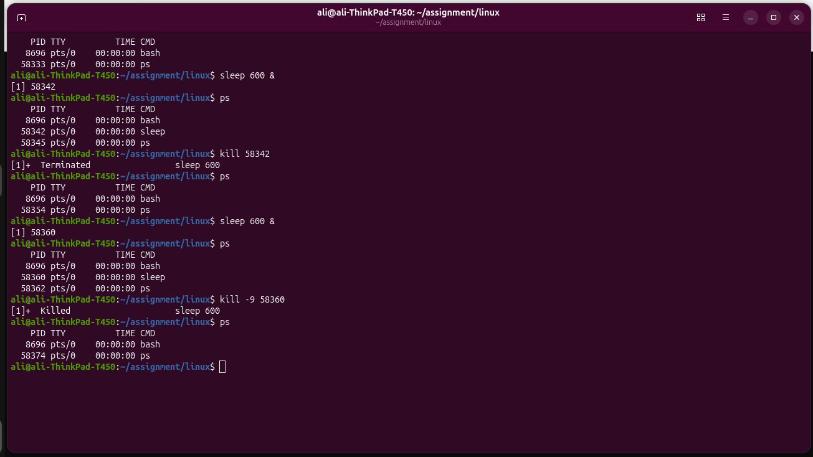

# Answers - DevOps Assignment 1


## Part 3, Task 1

Commands:
```
cd ~
mkdir devops-assignment-1
cd devops-assignment-1
git config --global init.defaultBranch main
git init
git config --global user.name "Ali Baqir"
git config --global user.email "alibaqir110@gmail.com"
git config user.name
git config user.email
```

Output:
```
Initialized empty Git repository in /home/ali/devops-assignment-1/.git/
Ali Baqir
alibaqir110@gmail.com
```

Explanation:
The git init create a hidden folder inside our project called .git.This folder is used by git to track who made the changes and to remember them .i have set my name and email so i can know after wards that who made these changes in project if project is shared with someone else ..

## Part 3, Task 2

Commands:
```
mkdir scripts screenshots tips
echo "# DevOps Assignment 1" > README.md
echo "# Answers - DevOps Assignment 1" > answers.md
printf '*.log\ntmp/\n.env\n' > .gitignore
cat .gitignore
echo "test log" > server.log
mkdir tmp
echo "temp" > tmp/temp.txt
echo "API_KEY=abc123" > .env
git status
git add .
git commit -m "Part 3: add README, answers and .gitignore"
```

Output:
```
*.log
tmp/
.env

On branch main

No commits yet

Untracked files:
  (use "git add <file>..." to include in what will be committed)
        .gitignore
        README.md
        answers.md

nothing added to commit but untracked files present (use "git add" to track)

[main (root-commit) d93c682] Part 3: add README, answers and .gitignore
 3 files changed, 5 insertions(+)
 create mode 100644 .gitignore
 create mode 100644 README.md
 create mode 100644 answers.md
```

Explanation:
server.log,tmp/ and .env is not shown in git status because they match the pattern of .gitignore git ignores these files so it never gets track down 
.env should never be uploaded on github because it has secret such as api keys and password and other information that is private .if it is uploaded any one who access our repo can see them and steal them because our repo is public 

## Part 1

### Question 1

Problem 1: The first problem that i identify is that the features that are made and added wait for three months to deploy in between multiple features are added and all get together and when they are released and gone live together the code breaks and nobody knows which new feature added has issues because multiple features are added together so root problem is not known .Dev Ops can fix problem like this by releasing new build every other day when new feature or bug fix is added and automation can be used so testing and releasing happens together and if there is issue in that feature it is pointed out easily and it can be easily fix 
Problem 2: The second problem that i found is that there are two seperate teams of Dev & Ops .There is no accountability one team blames the other team for the issue and simillarly the second team does the same .Dev Ops Solve this problem by making a one team which work together from coding to running the code.if any issues comes they will work together and find the issue because they all are accountable and they cant specifically blame any one.

### Question 2

1. Plan - GitHub Issues
2. Code - Git
3. Build - GitHub Actions
4. Test - pytest
5. Release - Docker images
6. Deploy - Kubernetes
7. Operate - Ansible
8. Monitor - Prometheus


### Question 3

Culture - Team members should check each others code and help each other if any mistake comes instead of blaming each other.

Automation - We can make a small script which automatically take backup of our project files so we dont have to do it manually every time.

Lean - We should make small commits after completing small work instead of adding all changes together at one time.

Measurement - We can count how many pull requests are merged every week to check how much work our team has completed.

Sharing - We can share useful tips and problems in our repository or GitHub issues so other team members can also learn from them.


### Question 4

(a) There are four DORA metrics :

Deployment frequency - it shows how many times we push our code to production in a given time . it is a Speed metric
Lead time for changes - it is how long a change takes from the moment i commit it till it is actually running live . it is also a Speed metric
Change failure rate - this shows what percentage of our deployments cause a problem and need a fix or rollback . it is a Stability metric
Time to restore service - it is the time that teams takes to get system backup after the system gets down .it is a stability metric.

The first two metrics are about speed and the last two are about stability .

(b)

An automated test that fails a push within minutes - it is called Feedback . the developer comes to know within few minutes that his code has broken something so he can correct it while the work is still fresh in his mind he remembers the changes.

A blameless review after an outage - this is Continual learning . after the system goes down the team discusses what went wrong and nobody is blamed , so everyone learns from it and the same mistake is avoided next time .

Releasing small changes every day instead of one big release every quarter - this is Flow . the work keeps on moving towards production in small parts instead of piling up and waiting for three months .


## Part 2, Task 1

Commands:

```
mkdir -p ~/assignment/linux/data/reports ~/assignment/linux/data/archive
ls -R ~/assignment/linux

```
Output:
```
/home/ali/assignment/linux:
data

/home/ali/assignment/linux/data:
archive reports

/home/ali/assignment/linux/data/archive:

/home/ali/assignment/linux/data/reports:

```

Explanation:
The mkdir -p command is used to create folders along with their parent folders if they do not already exist. In this command it created the assignment folder, then linux, data and reports and archive folders in one command. If any folder already exists it does not give an error and continues normally.

The ls -R command is used to show all folders and files inside a directory including the folders inside other folders. It shows the complete folder structure and also shows what is inside each folder.

## Part 2, Task 2

Commands:

```
cd ~/assignment/linux
touch report.txt run.sh
chmod 640 report.txt
chmod 754 run.sh
ls -l

```

Output:

```
total 4
drwxrwxr-x 4 ali ali 4096 Nov 27 23:29 data
-rw-r----- 1 ali ali 0 Nov 27 23:30 report.txt
-rwxr-xr-- 1 ali ali 0 Nov 27 23:30 run.sh

```
Explanation:

For report.txt i used 640 permissions. The owner can read and write the file but group members can only read it and others have no permission to access it. I used these permissions because report.txt is just a text file and everyone does not need to change it.

For run.sh i used 754 permissions. The owner can read, write and execute the file. Group members can read and execute it but cannot change it. Others can only read the file but cannot execute it. I used these permissions because run.sh is a script which needs execute permission to run.


## Part 2, Task 3

Commands:

```
printf 'INFO start\nERROR disk full\nINFO user login\nWARN slow response\nERROR timeout\nINFO user logout\nERROR disk full\nINFO backup done\nWARN memory high\nERROR timeout\nINFO restart\nERROR disk full\n' > server.log
grep ERROR server.log | wc -l
grep WARN server.log | wc -l
grep ERROR server.log | grep disk

```
Output:

```
5
2
ERROR disk full
ERROR disk full
ERROR disk full

```

Explanation:
The grep command is used to search for a specific word in a file. In this case grep ERROR server.log shows all the lines which contains the word ERROR. It prints the complete line instead of only showing the word.

The pipe (|) is used to pass the output of one command to another command. For example grep ERROR server.log | wc -l first finds all the ERROR lines and then passes them to wc -l instead of showing them on screen.

The wc -l command counts the total number of lines. In this task it counted the ERROR lines and gave the result 5. Similarly when i searched for WARN it gave 2 lines.

When we use two grep commands together like grep ERROR server.log | grep disk, the first grep finds all lines containing ERROR and the second grep searches for the word disk in those results. This way only the lines containing both ERROR and disk are shown. It works like applying one filter after another.


## Part 2, Task 4

Commands:

```
sleep 600 &
ps
kill 58342
ps
sleep 600 &
ps
kill -9 58360
ps
```

Output:
```
[1] 58342
PID TTY TIME CMD
8696 pts/0 00:00:00 bash
58342 pts/0 00:00:00 sleep
58345 pts/0 00:00:00 ps
[1]+ Terminated sleep 600
PID TTY TIME CMD
8696 pts/0 00:00:00 bash
58354 pts/0 00:00:00 ps
[1] 58360
PID TTY TIME CMD
8696 pts/0 00:00:00 bash
58360 pts/0 00:00:00 sleep
58362 pts/0 00:00:00 ps
[1]+ Killed sleep 600
PID TTY TIME CMD
8696 pts/0 00:00:00 bash
58374 pts/0 00:00:00 ps

```
Explanation:

The normal kill command sends SIGTERM signal which asks the process to stop and gives it some time to save its data and close properly. While kill -9 sends SIGKILL signal which forcefully stops the process immediately without giving it time to save data or close properly.

We should always try normal kill first because it allows the program to stop safely. We use kill -9 only when a program is stuck or not responding and does not stop with the normal kill command.



## Part 2, Task 5

Commands:

```
whoami
groups
sudo apt update
```

Output:

```
ali
ali adm cdrom sudo dip plugdev users lpadmin lxd
Hit:1 http://archive.ubuntu.com/ubuntu resolute InRelease
Hit:2 http://archive.ubuntu.com/ubuntu resolute-updates InRelease
Hit:3 http://archive.ubuntu.com/ubuntu resolute-backports InRelease
Hit:4 http://security.ubuntu.com/ubuntu resolute-security InRelease
All packages are up to date.

```

Explanation:
Using sudo is safer because it gives admin permission only for the command we want to run. It also asks for our password before running the command and keeps a record of which command we used. After the command is completed we are back to our normal user. But if we stay logged in as root every command we type has full permission and even a small mistake can delete important system files. That's why using sudo is better because it reduces the chances of making big mistakes.

## Part 3, Task 3

Commands:

```
echo "Author: Ali Baqir" >> README.md
git status
git add README.md
git status
git commit -m "Part 3: add author to README"

```

Output:

```
On branch main
Changes not staged for commit:
(use "git add <file>..." to update what will be committed)
(use "git restore <file>..." to discard changes in working directory)
modified: README.md

no changes added to commit (use "git add" and/or "git commit -a")

On branch main
Changes to be committed:
(use "git restore --staged <file>..." to unstage)
modified: README.md

[main fdd2794] Part 3: add author to README
1 file changed, 1 insertion(+)

```

Explanation:
After editing README.md the changes are in the working directory. Git knows that the file is changed but we have not added it for commit yet.

After using git add the changes move to the staging area. It means we have selected the changes which we want to save in our next commit.

After using git commit the changes are saved in the repository and become part of our project history. Now if we use git status it shows that there is nothing left to commit.


## Part 3, Task 4

Commands:

```
git remote add origin git@github.com:alibaqir110-web/devops-assignment-1.git
git push -u origin main
git remote -v
git log --oneline
```

Output:

```
Enumerating objects: 35, done.
Counting objects: 100% (35/35), done.
Delta compression using up to 4 threads
Compressing objects: 100% (31/31), done.
Writing objects: 100% (35/35), 209.16 KiB | 754.00 KiB/s, done.
Total 35 (delta 16), reused 0 (delta 0), pack-reused 0 (from 0)
remote: Resolving deltas: 100% (16/16), done.
To github.com:alibaqir110-web/devops-assignment-1.git

[new branch] main -> main
branch 'main' set up to track 'origin/main'.

origin git@github.com:alibaqir110-web/devops-assignment-1.git (fetch)
origin git@github.com:alibaqir110-web/devops-assignment-1.git (push)

b86ad5e (HEAD -> main, origin/main) Part 3: Task 3 answer
fdd2794 Part 3: add author to README
f9066e5 Part 2: Linux command line tasks
00a0fbd Part 1: Question 4 answer
502d1f0 Part 1: Question 3 answer
e88b0ba Part 1: Question 2 answer
98652eb Part 1: Question 1 answer
5834caf Part 3: add Task 2 answer
a77504a Part 3: add Task 1 answer
d93c682 Part 3: add README, answers and .gitignore

```

Explanation:

Origin is just a name given to our GitHub repository link. It connects our local project with GitHub so we dont have to write the full link every time we want to upload our code.

The git push -u origin main command uploads our main branch and all its commits to GitHub. The -u is used so Git remembers the connection between our local main branch and GitHub main branch. Next time we can simply use git push to upload our changes. It also created a new main branch on GitHub because it was not already there.

The git remote -v command shows the link of our GitHub repository. It shows fetch and push which are used for downloading and uploading changes. The git log --oneline command shows all our commits with their short IDs and messages. It showed 10 commits which means our work is saved in GitHub and both local and online branches are at the same point.


## Part 4, Task 1

Commands:

```

git switch -c add-notes
echo "# Notes" > notes.md
git add notes.md
git commit -m "Add notes.md"
echo "Branches keep work separate until it is ready." >> notes.md
git commit -am "Edit notes.md"
git switch main
git merge add-notes
git branch -d add-notes
git log --oneline --graph

```

Output:

```
Switched to a new branch 'add-notes'
[add-notes 638aae7] Add notes.md
 1 file changed, 1 insertion(+)
 create mode 100644 notes.md
[add-notes 784bc6c] Edit notes.md
 1 file changed, 1 insertion(+)
Switched to branch 'main'
Your branch is up to date with 'origin/main'.
Updating 5f3a3d2..784bc6c
Fast-forward
 notes.md | 2 ++
 1 file changed, 2 insertions(+)
 create mode 100644 notes.md
Deleted branch add-notes (was 784bc6c).
* 784bc6c (HEAD -> main) Edit notes.md
* 638aae7 Add notes.md
* 5f3a3d2 (origin/main) Part 3: Task 4 answer
* b86ad5e Part 3: Task 3 answer
* fdd2794 Part 3: add author to README
* f9066e5 Part 2: Linux command line tasks
* 00a0fbd Part 1: Question 4 answer
* 502d1f0 Part 1: Question 3 answer
* e88b0ba Part 1: Question 2 answer
* 98652eb Part 1: Question 1 answer
* 5834caf Part 3: add Task 2 answer
* a77504a Part 3: add Task 1 answer
* d93c682 Part 3: add README, answers and .gitignore

```

Explanation:

Yes it was a fast-forward merge because no one made any new commits in the main branch while we were working on the add-notes branch. We made two commits in add-notes and then merged it into main. Git simply moved the main branch forward to the latest commit of add-notes because there were no separate changes in main to combine. That's why Git did not create an extra merge commit and the commit history shows a straight line instead of two branches joining together.

## Part 4, Task 2

Commands:

```
echo "Hello from main" > greeting.txt
git add greeting.txt
git commit -m "Add greeting.txt"
git switch -c branch-a
echo "Hello from A" > greeting.txt
git commit -am "Branch A greeting"
git switch main
git switch -c branch-b
echo "Hello from B" > greeting.txt
git commit -am "Branch B greeting"
git switch main
git merge branch-a
git merge branch-b
cat greeting.txt
nano greeting.txt
cat greeting.txt
git add greeting.txt
git commit -m "Resolve conflict: keep both greetings"
git branch -d branch-a branch-b
git push

```

Output:

```
[main 7220e47] Add greeting.txt
1 file changed, 1 insertion(+)
create mode 100644 greeting.txt
Switched to a new branch 'branch-a'
[branch-a 25845b9] Branch A greeting
1 file changed, 1 insertion(+), 1 deletion(-)
Switched to branch 'main'
Switched to a new branch 'branch-b'
[branch-b 78c1cb6] Branch B greeting
1 file changed, 1 insertion(+), 1 deletion(-)
Switched to branch 'main'
Updating 7220e47..25845b9
Fast-forward
greeting.txt | 2 +-
1 file changed, 1 insertion(+), 1 deletion(-)
Auto-merging greeting.txt
CONFLICT (content): Merge conflict in greeting.txt
Automatic merge failed; fix conflicts and then commit the result.
```

The file with the conflict markers:
```
<<<<<<< HEAD
Hello from A
=======
Hello from B
>>>>>>> branch-b
```

```

After resolving:
Hello from A
Hello from B

[main 352aafc] Resolve conflict: keep both greetings
Deleted branch branch-a (was 25845b9).
Deleted branch branch-b (was 78c1cb6).
To github.com:alibaqir110-web/devops-assignment-1.git
5f3a3d2..352aafc main -> main

```

Explanation:

The `<<<<<<< HEAD` shows the changes that are already in our current branch (main). The `=======` is used to separate the two versions and `>>>>>>> branch-b` shows the changes coming from branch-b.

Git could not merge it automatically because both branches made different changes to the same line of the file. When changes are made to different lines Git can usually merge them automatically but when both branches change the same line it gets confused about which version to keep. That's why it stops and asks us to resolve the conflict manually.

## Part 4, Task 3

My pull request to my partner:
https://github.com/MuhammadFarazAhmedd/devops-assignment-1/pull/1

My partner's pull request to me:
https://github.com/alibaqir110-web/devops-assignment-1/pull/1

Partner's name: Muhammad Faraz Ahmed

## Part 4, Task 4

Commands:

```

echo "Part 6: scripts are in scripts/ and run with cron." >> notes.md
git commit -am "Add Part 6 notes. Closes #2"
git push

```

Output:

```

[main 9b0b13e] Add Part 6 notes. Closes #2
 1 file changed, 1 insertion(+)
Enumerating objects: 5, done.
Counting objects: 100% (5/5), done.
Delta compression using up to 4 threads
Compressing objects: 100% (3/3), done.
Writing objects: 100% (3/3), 360 bytes | 360.00 KiB/s, done.
Total 3 (delta 1), reused 0 (delta 0), pack-reused 0 (from 0)
remote: Resolving deltas: 100% (1/1), completed with 1 local object.
To github.com:alibaqir110-web/devops-assignment-1.git
   9da5cf7..9b0b13e  main -> main

```

Explanation:

GitHub automatically closes an issue when we use words like Closes #2 or Fixes #2 in our commit message. When we push that commit to the main branch GitHub checks the message and closes the related issue automatically. We don't have to go to the issue page and close it manually.

This is useful because sometimes we fix a problem but forget to close its issue. GitHub does it automatically when our changes are pushed to main. It also shows which commit fixed the issue so anyone can check it later.

The documentation label is used to identify issues related to documentation. Labels help us separate different types of issues like bugs, documentation and new features so they are easier to find.

